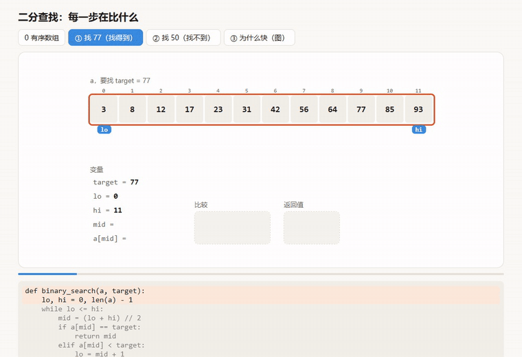
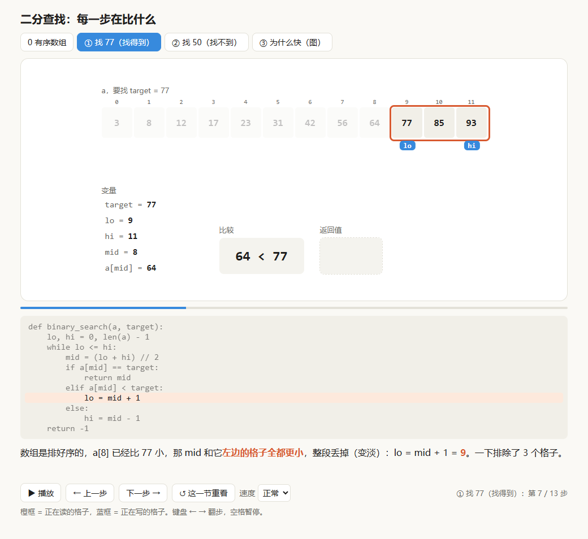
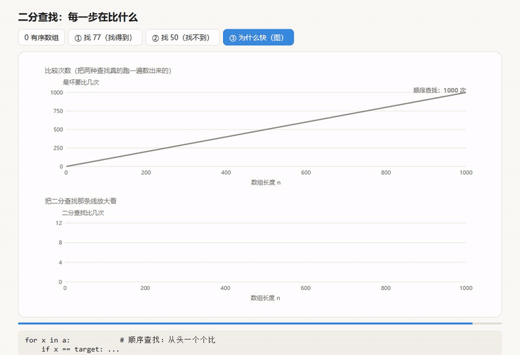

# step-animation：把学习材料变成「一步一步」的动画网页

一个 [Claude Code](https://claude.com/claude-code) skill。把一段讲义文字、一段代码或一个算法交给它，它会生成一个**独立的 HTML 网页**（双击就能打开，不联网），用小格子里的数字一步一步演示：

- 数据画成小的**数字格子**（图片 = 一张数字表格，数组 = 一排格子）
- 数字从输入格子**飞到**结果格子
- **橙框** = 正在读的格子，**蓝框** = 正在写的格子，框会平滑移动
- 每一步显示**正在执行的那行代码** + 一句**大白话**说明
- 自动播放，停多久按说明长短算；可以暂停、上一步、下一步、调速度，键盘 ← → 和空格也能控制
- 能嵌入真实数据画折线图，线条会**一笔一笔画出来**，标注自动避开重叠



## 为什么做这个

单看代码（尤其是不熟的语言，比如会 Java/C、不熟 Python 和 NumPy）很难看懂「每一行到底对数据做了什么」。把数据缩到几个格子、让每一步都**看得见**，一下就懂了。这个 skill 把这种讲法做成了可复用的流程：Claude 负责拆步骤、写说明、生成网页，并且**自己检查每一步**都没有报错、没有标注重叠。

## 效果

| 二分查找（找得到 / 找不到 / 为什么快） | 冒泡排序（相邻比较、交换） |
|---|---|
|  |  |
| **真实数据画图** | **滑动窗口**（一个全新的 Claude 只读 SKILL.md 写出来的） |
|  |  |

可以直接下载 `examples/` 里的 `.html` 用浏览器打开看。完整的演示视频：[docs/demo.mp4](docs/demo.mp4)。

## 安装

需要 [Node.js](https://nodejs.org/)（18 以上）。自检和截图还需要本机装有 Chrome 或 Edge。

```bash
# 装到个人 skill 目录（所有项目都能用）
git clone https://github.com/Rinta13795/step-animation-skill ~/.claude/skills/step-animation
cd ~/.claude/skills/step-animation
npm install          # 只装 puppeteer-core，用来无界面自检、截图
```

Windows PowerShell 里把 `~` 换成 `$HOME` 即可。

## 用法

在 Claude Code 里直接说：

> 用 step-animation 把这段代码一步一步演示给我看：（贴代码或讲义）

或者 `/step-animation` 加上你的材料。Claude 会：

1. 把材料拆成「节 → 步」（一节一个知识点，一步一个动作）；
2. 用 JS 把材料里的计算**真的跑一遍**，网页上的数字全部是算出来的；
3. 写课程文件 `xxx.lesson.js`，用 `build.mjs` 生成独立网页；
4. 用 `check.mjs` 把**每一步**都跑一遍自检，有问题就改，直到通过；
5. 截几张图自己看一眼，再交给你。

也可以自己手写课程：

```bash
cp template/lesson.js my.lesson.js      # 从骨架开始
node build.mjs my.lesson.js             # 生成 my.html
node check.mjs my.html                  # 自检（再加 --width 760 查窄屏）
node tools/snap.mjs my.html shots 0:2 1:1   # 截图：节(最左边的标签是 0) : 步(网页上的「第 k 步」)
```

## 自检会查什么

在浏览器里打开 `网页.html?check`，或者运行 `node check.mjs 网页.html`。每一步跑两遍（瞬间模式 + 8 倍速动画模式），报告：

| 问题 | 说明 |
|---|---|
| 报错 | 任何 JS 异常，包括动画回调里的 |
| 标注重叠 | 文字标签、格子、指针、图表文字互相压住 |
| 标注压住圆点 / 压线 | 图表文字压在圆点或曲线上 |
| 超出画布 / 超出图表 | 东西伸出去被裁掉 |
| 框没对准 | 框或指针没有对准它要指的格子 |
| 文字撑出格子 | 数字太长，格子装不下 |
| 重放不一致 | 动画播完的画面和「瞬间重放」不一样（按「上一步」会出错） |
| 缺内容 | 某一步没写代码或说明、某一节没有步骤、课程文件有语法错误 |

## 目录

```
SKILL.md              skill 说明：什么时候用、怎么拆节和步、怎么写代码行和说明
engine/engine.js      引擎：格子、框、飞行数字、指针、变量面板、表格、折线图、播放器、自检
engine/engine.css     样式（自动适配深色模式）
build.mjs             课程文件 + 引擎 → 独立 HTML
check.mjs             无界面跑自检
tools/snap.mjs        给指定步骤截图
template/lesson.js    课程文件骨架
reference/api.md      引擎函数说明
examples/             二分查找、冒泡排序、滑动窗口（.lesson.js 源文件 + 生成好的 .html）
promo/                演示视频的制作脚本（录屏、合成音乐、逐帧渲染）
docs/                 README 用的截图、GIF 和演示视频
```

## 引擎是怎么工作的（给想改引擎的人）

每一步只写「这一步的变化」。翻到第 k 步时，引擎会：重新搭舞台 → **瞬间重放**第 0 ~ k−1 步（关掉所有动画和 CSS 过渡）→ **带动画**播放第 k 步。所以上一步、下一步、跳节都不会乱，课程作者也不用操心「回到前面时要恢复哪些状态」。自检里的「重放不一致」就是在查这件事有没有被破坏。

## License

MIT
