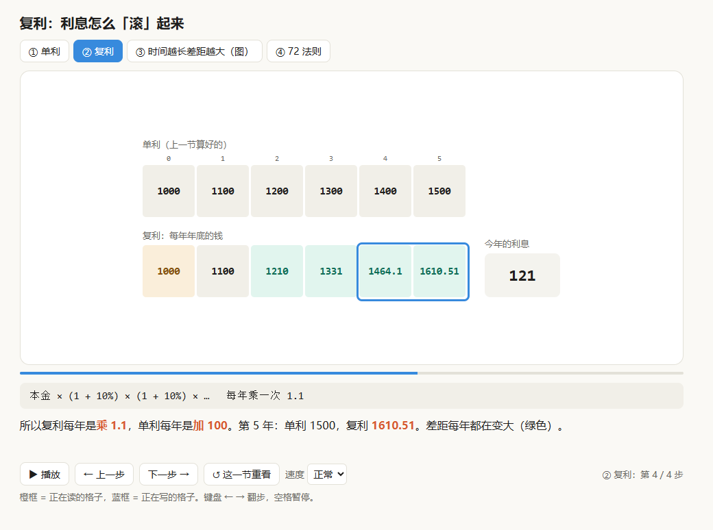
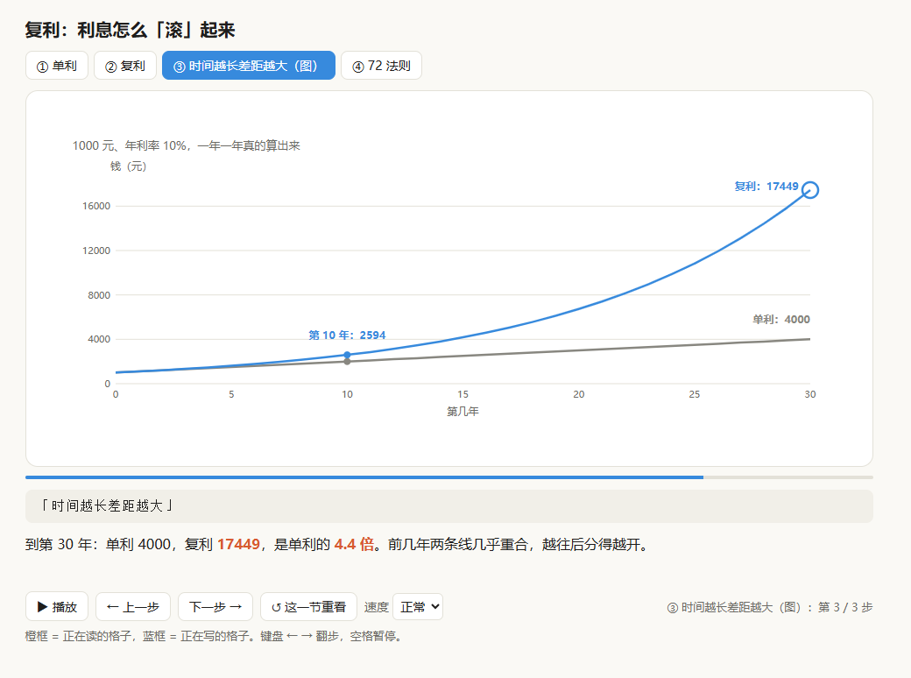
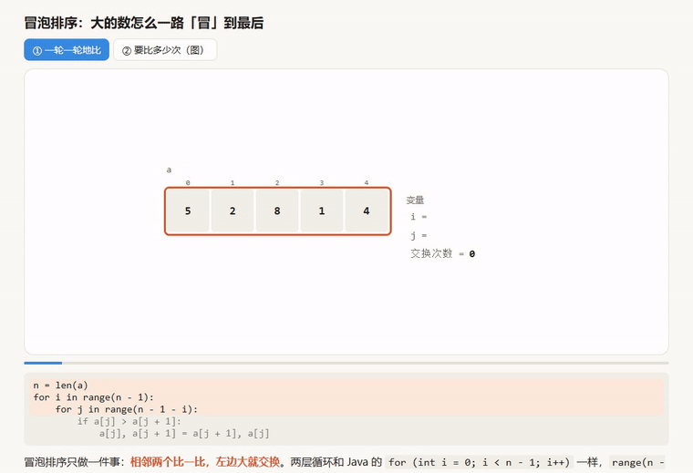
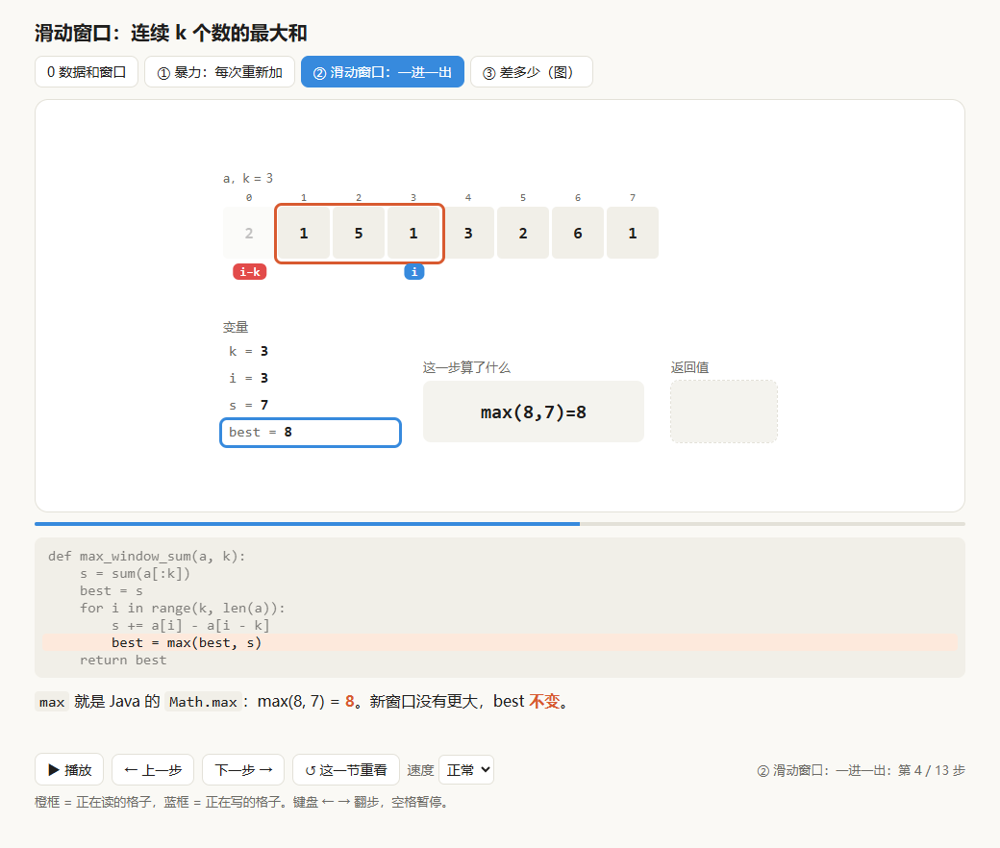

# step-animation: turn anything you're learning into a step-by-step animation

**English** | [简体中文](README.zh-CN.md)

A [Claude Code](https://claude.com/claude-code) skill. Give it **any learning material** — a paragraph from lecture notes or an article, a concept or formula, a process, a piece of code or an algorithm, or a whole file (.md / .pdf / .docx / .pptx / .txt / .csv) — and it builds a **single standalone HTML page** (double-click to open, works offline) that walks through it one step at a time:

- Data is drawn as small **grids of numbers** (an image is a table of numbers, an array is a row of cells)
- Numbers **fly** from the cells being read into the result cell
- **Orange frame** = cell being read, **blue frame** = cell being written; frames glide from step to step
- Every step shows the **source line** it explains (the sentence from the notes, the formula, or the line of code) plus a **plain-language** caption
- Autoplays, pausing longer on longer captions; pause, previous, next and speed controls, plus ← → and Space on the keyboard
- Real data can be embedded as line charts that **draw themselves**, with labels that automatically avoid overlapping


> The bundled examples and the generated pages are in Chinese (the author's language); the engine and the skill work with material in any language.

## Why

Whether it's code in a language you don't know well, or a sentence in your notes like "the interest is added to the principal, so next year the interest earns interest too", reading text alone rarely lets you *see* what actually happens. Shrink the data to a handful of cells, make every step visible, and it clicks. This skill turns that teaching style into a repeatable workflow: Claude splits the material into steps, writes the captions, builds the page, and **checks every single step** for errors and overlapping labels before handing it over.

## Examples

| **Compound interest** (input is just a paragraph of text, no code) | **Compound interest**: the gap over 30 years |
|---|---|
|  |  |
| Binary search (found / not found / why it's fast) | Bubble sort (compare neighbours, swap) |
|  |  |
| **Charts from real data** | **Sliding window** (written by a fresh Claude that had only read SKILL.md) |
|  |  |

Download any `.html` in `examples/` and open it in a browser. Full demo video: [docs/demo.mp4](docs/demo.mp4).

## Install

Requires [Node.js](https://nodejs.org/) 18+. The self-check and screenshot tools also need Chrome or Edge installed.

```bash
# install as a personal skill (available in every project)
git clone https://github.com/Rinta13795/step-animation-skill ~/.claude/skills/step-animation
cd ~/.claude/skills/step-animation
npm install          # only puppeteer-core, for the headless self-check and screenshots
```

On Windows PowerShell, use `$HOME` instead of `~`.

## Usage

Just ask Claude Code:

> Use step-animation to walk me through this step by step: (paste notes, a concept, or code)

> Use step-animation to turn the gradient descent part of `chapter3.pdf` into an animation

or type `/step-animation` followed by your material. Claude will:

1. Read the material (extracting the text from files first), find what changes step by step, and split it into **sections → steps** (one idea per section, one action per step);
2. **Actually run** the calculations in JS, so every number on the page is computed, not typed in;
3. Write a lesson file `xxx.lesson.js` and build a standalone page with `build.mjs`;
4. Run the self-check over **every step** with `check.mjs`, fixing and re-running until it passes;
5. Take a few screenshots to eyeball the result, then hand it to you.

You can also write lessons by hand:

```bash
cp template/lesson.js my.lesson.js          # start from the skeleton
node build.mjs my.lesson.js                 # -> my.html
node check.mjs my.html                      # self-check (add --width 760 for narrow screens)
node tools/snap.mjs my.html shots 0:2 1:1   # screenshots: section (leftmost tab = 0) : step (the "k" in "step k / n")
```

## What the self-check catches

Open `page.html?check` in a browser, or run `node check.mjs page.html`. Each step runs twice (instant mode + animated at 8× speed) and reports:

| Problem | Meaning |
|---|---|
| Error | Any JS exception, including inside animation callbacks |
| Overlapping labels | Text labels, cells, pointers or chart text covering each other |
| Label on a dot / line | Chart text sitting on a dot or a curve |
| Outside canvas / chart | Something sticks out and gets clipped |
| Frame misaligned | A frame or pointer isn't on the cell it should point at |
| Text overflows cell | A number too long for its cell |
| Replay mismatch | The state after the animation differs from the instant replay (breaks the Previous button) |
| Missing content | A step without source line or caption, an empty section, or a lesson file with a syntax error |

## Layout

```
SKILL.md              the skill: when to use it, how to read the material, split sections/steps, write source lines and captions
engine/engine.js      engine: grids, frames, flying numbers, pointers, variable panel, tables, line charts, player, self-check
engine/engine.css     styles (light and dark mode)
build.mjs             lesson file + engine -> standalone HTML
check.mjs             headless self-check
tools/snap.mjs        screenshot given steps
template/lesson.js    lesson skeleton
reference/api.md      engine API reference
examples/             compound interest (plain-text material), binary search, bubble sort, sliding window (.lesson.js + built .html)
promo/                scripts that made the demo video (screen capture, synthesized music, frame-by-frame render)
docs/                 screenshots, GIFs and the demo video used in this README
```

## How the engine works (for contributors)

Each step only describes *its own change*. When you jump to step k, the engine rebuilds the stage → **instantly replays** steps 0…k−1 (with all animations and CSS transitions off) → plays step k **animated**. So previous/next/jumping between sections never gets out of sync, and lesson authors never have to think about restoring state. The "replay mismatch" check guards exactly this.

## License

MIT
